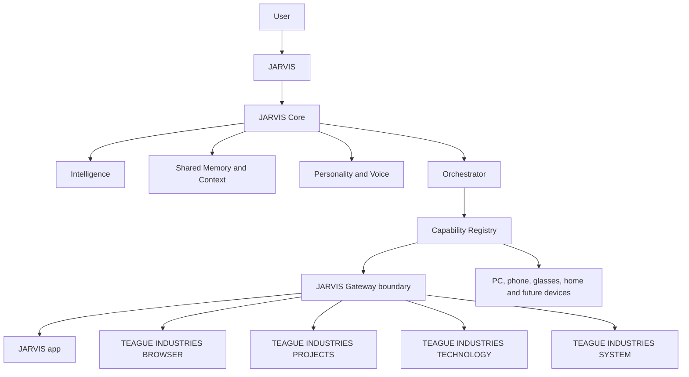
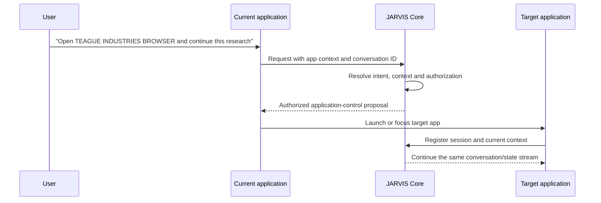
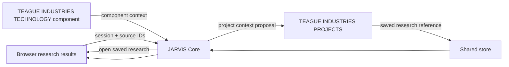

# Teague Industries Software Suite — Design Checkpoint

**Status:** Design and architecture only — 10 September 2026  
**Decision gate:** Stop here for review before implementation  
**Invariant:** One JARVIS, one Core, one memory, one identity, many applications and devices.

This document describes the proposed Teague Industries software family without creating the five production applications or changing JARVIS Core.

## 1. Current architecture audit

The existing application already provides the central authority required by the suite:

| Existing component | Current role | Suite decision |
|---|---|---|
| `server.py` and `App` | Single local JARVIS runtime, provider routing, conversation execution and state | Preserve as the Core host during this phase |
| `store.py` | Shared conversations, memory, projects, tasks, documents, reminders and logs | Preserve as the shared memory/context store |
| `conversation_context.py` and `workspaces.py` | Context selection and project context | Reuse; later expose through Core contracts |
| `device_registry.py` | Device presence, capabilities and interaction device | Preserve as the authoritative capability registry |
| `wearables/` | Generic wearable contracts, mock device, real Core adapter and pipeline | Preserve as the device adapter boundary |
| `phone_bridge.py` and `phone/` | Authenticated phone task bridge and phone client | Treat as a client adapter, not another assistant |
| `ios/JARVIS/` | iOS client/domain/session scaffold with Core-issued state values | Preserve as the future iOS interface port |
| `static/index.html`, `app.js`, `navigation.js`, `teague.css`, `teague.js` | Shared desktop shell and presentation system | Reuse the shell patterns and Teague design tokens |
| `desktop/` | Authenticated Electron shell, capture authority and desktop controls | Keep PC as a first-class device/application |

No second production personality, memory store or reasoning stack was found. The mock Core is explicitly test-only, as required by `AGENTS.md`.

## 2. Target suite architecture



The gateway is a future authenticated boundary around the existing Core. It is not a reason to duplicate Core logic inside each application.

## 3. Application boundaries and screen maps

### JARVIS

**Purpose:** Primary direct conversation surface. It owns no separate intelligence; it is the richest client of the existing Core.

**Screens:** Command/briefing, Communications, Vision, Memory, Projects context, Voice and hologram state, Mission Log, Settings and System entry points.

**Classification:** Existing desktop shell; shared Teague branding is UI-only and available now. A standalone future client would require the Gateway.

### TEAGUE INDUSTRIES BROWSER

**Purpose:** Web and research workspace.

**Screens:** Browser home/search, tab workspace, page reader, JARVIS research rail, source/evidence drawer, saved research and research session history.

**Boundaries:** Browser handles tabs and page presentation. JARVIS Core handles summaries, context, citations, tool policy and memory writes.

**Classification:** Research UI is UI-only/can build later; robust page automation, Mail and Drive require external integrations and Gateway access.

### TEAGUE INDUSTRIES PROJECTS

**Purpose:** Projects, goals, tasks and durable project knowledge.

**Screens:** Portfolio, project overview, goals/milestones, tasks/next actions, blockers/dependencies, files/notes, decisions, activity timeline and project JARVIS panel.

**Boundaries:** Project records remain in the shared store/Core. This application presents and proposes changes; authorization remains Core-owned.

**Classification:** Current project/task screens are Existing; richer portfolio UI is UI-only; Core 2.0 Goal/Project Manager is required for dependency planning and autonomous sequencing.

### TEAGUE INDUSTRIES TECHNOLOGY

**Purpose:** Hardware, devices, experiments and engineering knowledge.

**Screens:** Technology overview, device registry, JARVIS systems map, hardware inventory, J1 workspace, wearable lab, experiments/benchmarks, telemetry, documentation and test evidence.

**Boundaries:** It reads capability/device data from Core. It cannot create a second device registry or grant hardware authority.

**Classification:** Mock wearable lab and registry data are Existing; polished screens are UI-only; physical Meta/Teague adapters require verified external SDKs and a future hardware gate.

### TEAGUE INDUSTRIES SYSTEM

**Purpose:** Engineering and control console for JARVIS.

**Screens:** Core health, providers/API usage, memory health, devices/capabilities, permissions/security, diagnostics/logs, latency, failures, network and backups.

**Boundaries:** Observability and safe controls only. It must not bypass Core authorization or expose secrets.

**Classification:** Existing System Status/Settings/Mission Log provide a base; aggregated health and usage views are UI-only once data exists; provider billing and external service details require integrations.

## 4. Shared JARVIS interaction model

Every application gets a persistent, compact JARVIS control using the same Core session:

- collapsed state: Teague mark plus current JARVIS state;
- expanded state: side rail with transcript, microphone, attach/vision, current context and response controls;
- speaking state: shared hologram/audio indicator sourced from the Core state stream;
- command result: an application action proposal with the existing authorization affordance.

The control is a client surface, not a second assistant. Conversation ID, memory references, user preference and state events remain Core-issued.

Shared states: `OFFLINE`, `IDLE`, `LISTENING`, `LOOKING`, `THINKING`, `SPEAKING`, `EXECUTING`, `ERROR`.

## 5. Navigation and context flows

### User → current app → JARVIS → target app



Application focus changes are reversible UI actions. Sending mail, deleting files, purchases, security changes and other consequential actions still require their existing authorization path.

### Cross-application context



Use stable IDs for conversations, research records, projects, documents and devices. Pass references and bounded summaries rather than copying entire histories between applications.

## 6. Proposed Gateway contracts

These are design contracts only; no production gateway is being implemented now.

### Session registration

```json
{
  "application_id": "teague-technology",
  "instance_id": "local-instance-id",
  "user_id": "local-user",
  "conversation_id": "core-issued-id",
  "context": {"project_id": "jarvis-j1", "screen": "experiment"},
  "capabilities": ["display", "navigation", "file_picker"]
}
```

### Intent request

```json
{
  "conversation_id": "core-issued-id",
  "source": {"application_id": "teague-browser", "device_id": "pc"},
  "input": {"type": "text", "text": "save the best three to J1"},
  "context_refs": ["research-session:123", "project:jarvis-j1"],
  "requested_outputs": ["project_update", "display", "voice"]
}
```

### Core event stream

Events are bounded and typed: `state`, `assistant.delta`, `assistant.complete`, `tool.proposed`, `tool.authorization_required`, `tool.result`, `context.updated`, `device.changed`, `error`. Clients must treat Core events as authoritative and reconnect without creating a new identity.

### Capability request

```json
{
  "request_id": "core-issued-request",
  "capability": "application.navigation",
  "provider": "teague-browser",
  "action": "focus",
  "arguments": {"route": "/research/123"},
  "authorization": "required-or-not-required-by-core"
}
```

Applications return an outcome; they do not decide whether a consequential action is permitted.

## 7. Capability ownership

| Capability | Owner/provider | Classification |
|---|---|---|
| Chat, personality, reasoning, voice configuration | Existing JARVIS Core | Existing |
| Memory and conversation context | Existing Store/Core | Existing |
| PC display, files, applications and desktop controls | PC adapter + existing desktop shell | Existing |
| Camera/microphone/speaker devices | Device adapters and registry | Existing for mock devices; physical integrations are Future/external |
| Browser tabs and page capture | TEAGUE INDUSTRIES BROWSER client | UI-only first; external integrations for deeper services |
| Projects/goals/tasks | Existing store and workspaces | Existing base; richer planning requires Core 2.0 |
| Health, latency and diagnostics | Existing logs/timings/providers | Existing base; aggregation is UI-only |
| Mail/Drive | Authorized provider adapters | Requires external integration |
| Cross-app launch/focus | Application-control capability | Requires Gateway and Core authorization contract |

## 8. Repository proposal

Do not create these production folders yet. The eventual layout should keep Core and clients separate:

```text
jarvis/
  core/                 # existing Python Core services; remains authoritative
  gateway/              # future authenticated transport boundary
  clients/
    jarvis/             # primary conversation UI
    teague-browser/     # research UI
    teague-projects/    # project UI
    teague-technology/  # engineering UI
    teague-system/      # operations UI
  devices/              # generic adapters; physical adapters remain optional
  shared/
    contracts/          # versioned wire contracts and state enums
    design/             # Teague tokens, icons and shared components
  tests/
    contracts/
    gateway/
    clients/
```

Near-term reuse should remain in the current repository: `static/` for the shell, `server.py`/`store.py` for Core, `wearables/` for device contracts, `desktop/` for PC authority and `ios/` for the client port. Do not migrate files solely to match this future layout.

## 9. Security and authentication

- Applications authenticate to the local/remote Gateway with short-lived, scoped application credentials.
- Device credentials and provider secrets stay in Core-side configuration; never ship them to a client, browser page or wearable.
- Every request carries an application ID, device ID, conversation ID and correlation/request ID.
- Capability registration describes availability; it does not grant authority.
- Core evaluates user intent, privacy, device permissions and action risk.
- Applications display authorization prompts returned by Core and report the result.
- Camera and microphone capture remains task-driven with explicit permissions and clear lifecycle events.
- Mail, Drive, purchases, deletion, security changes and outbound communications require their existing confirmation/authorization levels.

## 10. Lifecycle and failure model

1. Application starts and authenticates.
2. It registers its application capabilities and current screen context.
3. Core associates it with an existing or new Core-issued conversation.
4. The client subscribes to state/events and sends heartbeats.
5. On disconnect, Core marks only that application/device unavailable; JARVIS and shared memory remain online.
6. Reconnection resumes by conversation ID and last event cursor; it never creates a second JARVIS.
7. Unsupported capability or provider failure returns a typed error and a safe fallback suggestion.

## 11. Mock-data strategy

Design work can use deterministic fixtures without pretending they are live:

- mock application registry with all five application IDs;
- mock shared conversation and project references;
- mock state/event stream covering every shared state;
- mock capability providers for PC, glasses, phone and J1;
- mock Browser research records with explicit `simulated: true`;
- mock System health data labelled `NOT MEASURED` where the Core has no source.

Fixtures must not contain credentials, copied personality prompts or an independent memory database.

## 12. Classification summary

| Proposed area | Classification |
|---|---|
| Teague branding/tokens/shared shell patterns | UI-only / can build now |
| JARVIS app existing conversation, voice, memory and hologram | Existing |
| TEAGUE INDUSTRIES PROJECTS richer layouts over current records | UI-only / can build now |
| TEAGUE INDUSTRIES TECHNOLOGY mock registry and experiment views | UI-only / can build now |
| TEAGUE INDUSTRIES SYSTEM views over existing diagnostics and logs | UI-only / can build now |
| Browser tabs and local research presentation | UI-only / can build now |
| Cross-application persistent JARVIS control | Requires JARVIS Gateway for independent app processes |
| Cross-app navigation with continued conversation | Requires JARVIS Gateway plus Core application-control capability |
| Goal/dependency planning and autonomous project sequencing | Requires Core 2.0 |
| Mail, Drive, cloud files and external research providers | Requires external integration and Gateway |
| Physical Meta/Teague hardware | Future; official SDK and hardware gate required |
| Five production applications | Future; do not build in this phase |

## 13. Risks and conflicts

1. **Identity split risk:** Each app could accidentally create its own conversation, prompt or memory store. Mitigation: Core-issued conversation IDs and a single gateway client library.
2. **Authorization drift:** Client-side controls could bypass Core policy. Mitigation: clients can propose, Core authorizes.
3. **Context leakage:** Passing full transcripts to every app increases privacy and latency. Mitigation: stable references plus least-privilege context envelopes.
4. **Gateway becoming a second Core:** Business logic may migrate into transport code. Mitigation: Gateway validates/authenticates/routes only; Core owns decisions.
5. **State divergence:** Local UI states may disagree with Core. Mitigation: shared state enum and Core event stream.
6. **External integration coupling:** Mail/Drive/browser vendors can impose different auth and lifecycle rules. Mitigation: adapters with explicit scopes and failure states.
7. **Desktop regression:** Splitting the current shell too early could damage verified PC behavior. Mitigation: keep the current app intact until a contract-backed client is proven.

No conflict with the existing ONE-JARVIS architecture is required. The only architectural constraint is that “five applications” must remain five interfaces, never five assistants.

## 14. Recommended implementation order after approval

1. Freeze this design and version shared IDs/state/event contracts.
2. Build a UI-only suite navigation prototype inside the existing shell or a separate mock harness; no new production processes.
3. Add deterministic mock application registry and event fixtures.
4. Define and test a minimal authenticated Gateway contract against the existing Core adapter, without changing Core reasoning or memory.
5. Build the persistent JARVIS control in one client first and verify conversation/state continuity.
6. Add Projects, Technology and System views over existing APIs/data.
7. Add Browser research UI and source references.
8. Add cross-application focus/navigation only after authorization and reconnect tests pass.
9. Add external Mail/Drive integrations independently with scoped credentials.
10. Reassess Core 2.0 requirements before any planning refactor or physical-device work.

## Decision checkpoint

This document is the complete design checkpoint. No five production applications, Gateway, Core refactor, provider change, memory change, authorization change or physical integration was implemented. The next step requires explicit approval of the architecture and implementation order.
